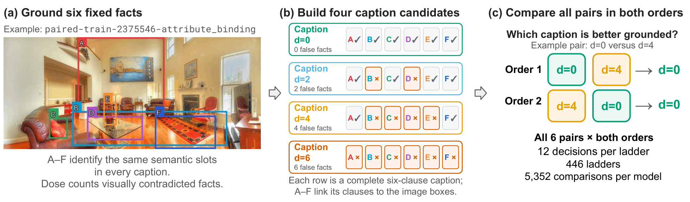

# SemanticStress

### A dose-controlled benchmark for visual-semantic grounding

Accepted at WACV 2027 (Datasets Track)

Haoran Zhao · Biao Xiang · Sehyuk Park · Eduard Hovy · Caren Han



SemanticStress contains 446 image–caption ladders. Each ladder holds six grounded fact slots fixed while pair swaps produce four captions with 0, 2, 4, or 6 visually contradicted facts. The released data cover object identity (124 ladders), attribute binding (118), compositional binding (82), and spatial relations (122).

This repository provides the dataset and the small amount of code needed to prepare its images. Source-image files are not redistributed.

## Get the data ready

The captions and box coordinates are already in [`data/ladders_n446.jsonl`](data/ladders_n446.jsonl). To download the corresponding Visual Genome images and draw the labeled boxes used by the benchmark:

```bash
python -m pip install -r requirements.txt
python scripts/prepare_images.py
```

The script uses the source URLs in [`data/image_sources_n446.jsonl`](data/image_sources_n446.jsonl) and writes each image to the `image_path` recorded in the ladder file. It skips images that are already present and can be rerun after an interrupted download. To check the metadata without downloading anything, run `python scripts/prepare_images.py --check`.

Once images are ready, a row can be loaded with standard Python:

```python
import json
from pathlib import Path

with open("data/ladders_n446.jsonl", encoding="utf-8") as file:
    ladder = json.loads(next(file))

image = Path(ladder["image_path"])
captions = ladder["captions"]
print(ladder["factor"], image)
print(captions["preserve"], captions["low"], captions["mid"], captions["high"])
```

Run this from the repository root. Every row also includes `boxes`, `image_id`, image dimensions, and `doses`. The four caption keys are `preserve`, `low`, `mid`, and `high`, corresponding to doses 0, 2, 4, and 6. The dose is a count of contradicted facts within one ladder, not a general difficulty score across images.

## Files

| Path | Purpose |
|:--|:--|
| [`data/ladders_n446.jsonl`](data/ladders_n446.jsonl) | Final captions, boxes, source identifiers, and image paths |
| [`data/image_sources_n446.jsonl`](data/image_sources_n446.jsonl) | URLs for obtaining the 446 source images |
| [`scripts/prepare_images.py`](scripts/prepare_images.py) | Download images and render box labels |
| [`DATA_CARD.md`](DATA_CARD.md) | Scope and limitations |
| [`THIRD_PARTY_ASSETS.md`](THIRD_PARTY_ASSETS.md) | Upstream sources and image-rights boundary |

The public release contains the final 446 ladders, not individual review notes or excluded candidates. It does not include model outputs or experiment-running code. See the paper for the evaluation protocol and reported results.

## Citation

```bibtex
@inproceedings{zhao2027semanticstress,
  title     = {SemanticStress: A Dose-Controlled Benchmark for Visual--Semantic Grounding},
  author    = {Zhao, Haoran and Xiang, Biao and Park, Sehyuk and Hovy, Eduard and Han, Caren},
  booktitle = {Proceedings of the IEEE/CVF Winter Conference on Applications of Computer Vision},
  year      = {2027}
}
```

The included code and original documentation are under the [MIT License](LICENSE). The source images and annotations remain subject to upstream rights and terms; see [third-party assets](THIRD_PARTY_ASSETS.md).
